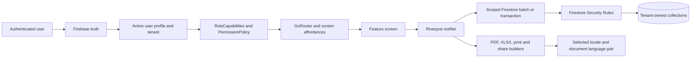

# Governance Pack Update

## Status and scope

This update records verified local contracts and explicit blockers for the
bounded audit at baseline `6e5a4337f506d0713fe0463fb6f0ec0cef259b04`.
It does not claim complete repository coverage or production signoff.

## Authoritative role model

The app-side capability source is [role_names.dart](../../app/lib/core/utils/role_names.dart)
and [permission_policy.dart](../../app/lib/core/utils/permission_policy.dart).
Firestore remains the independent authorization boundary in
[firestore.rules](../../firestore.rules).

| Role | Verified app capability summary | Boundaries |
| --- | --- | --- |
| `super_admin` | Workspace administration; platform settings hub; selected-workspace operations where a valid support context is required | No business data without an explicit selected workspace, reason, active context, and unexpired support window. Start/end events are append-only and the selected profile links to the start event. |
| `tenant_admin` | Tenant business administration, users in permitted target roles, settings, reports, notifications, backups, invoices | Cannot cross tenant scope or assign reserved platform roles. |
| `admin` / legacy `manager` | Tenant business operations and seller account management | Must not be treated as a platform role. |
| `supervisor` | Operational routes, shops, products, inventory, invoices, reports, notifications | No user administration, settings, backup, financial correction, invoice settlement/void, credit note, route-seller assignment, or shop-route reassignment. |
| `seller` | Read operational data and create route-scoped shops, transactions, sale invoices, and cash receipts | Assigned-route and own-profile constraints apply; no settlement/correction/void or admin data access. |

This is the currently encoded policy, not a configurable permission registry.
Dynamic super-admin capability configuration is **BLOCKED** pending an
approved capability set, version/migration contract, Rules-enforced storage
schema, cache invalidation, and revocation semantics. Missing configuration
must remain deny-by-default.

## Verified architecture and trust boundaries

The client policy and router improve consistency but are not the trust
boundary. Firestore Rules independently validate active profile, active
tenant, role, target tenant, route ownership, support context, and atomic
financial/inventory links. The platform super-admin is an operator, not a
global business-data reader. Rules access-call limits and cache behavior are
separate operational risks and are not proven by this diagram.

## Threat model checkpoints

| Threat actor / condition | Required control | Current evidence / gap |
| --- | --- | --- |
| Seller changes a tenant or route identifier | Provider guard plus Rules ownership checks | Rules Emulator suite covers tested role/tenant paths; production deployment remains pending for the newest support-link change. |
| Stale singleton provider after tenant switch | Tenant-keyed provider family and invalidation | Notification tenant-switch regression exists; broader provider-cache audit remains partial. |
| Super-admin accesses business data without support context | Explicit workspace, reason, TTL, and linked append-only event | Linked event contract tested locally; deployment pending. |
| Workspace administrator attempts platform role escalation | Restrict target-role capability and independently enforce Rules | Existing role policy source reviewed; full CRUD integration and the privileged bootstrap utility need further review. |
| Bulk maintenance script targets the wrong tenant or fails midway | Disabled legacy scripts until record mapping and recovery are designed | Three dangerous reset/backfill scripts now fail closed; `promote_super_admin.js` remains owner-review required. |
| Malformed or absent permission configuration | Deny-by-default validated policy version | Runtime-configurable permissions are not implemented; no allow-all fallback exists in the current static role matrix. |

## Data maintenance and reset safeguards

- The app database-flush provider and UI remain fail-closed.
- `flush_dev_data.js`, `tool/backfill_tenant_id.js`, and
  `tool/backfill_missing_tenant_id.js` now fail closed. The latter two cannot
  safely assign every unscoped record to one tenant in a multi-workspace
  database.
- Plaintext backup/restore and direct-balance reset stubs remain disabled.
- No workspace-admin feature reset was implemented. A safe implementation
  requires approved module scope, dependency graph, preview semantics,
  retention, recovery, per-step audit, idempotency, retry, and partial-failure
  policy. Financial rows and `shop.balance` cannot be independently reset.
- `promote_super_admin.js` remains an owner-review item; it is a direct
  privileged profile-role patch with no matching platform access event.

## Change-control workflow

1. Establish branch, commit, divergence, and dirty files before editing.
2. Trace the full UI/provider/model/Rules/data path; label evidence versus
   hypothesis.
3. Reproduce with a failing test before the smallest root-cause fix.
4. Test tenant isolation and denied payloads at Firestore Rules, not only UI.
5. Run focused tests, analyzers, then the broadest feasible suite.
6. Review the complete diff for authorization weakening, partial writes,
   financial drift, secrets, and unrelated changes.
7. Update the regression ledger, relevant skills, and audit evidence.
8. Treat build, install, Rules/index deployment, Hosting, commit, and push as
   separate authorized operations.

## Required quality gates

- Flutter changes: focused test, `flutter analyze lib --no-pub`, and
  `dart analyze test/`; PDF-capable commands include
  `--dart-define=use_arabic=true`.
- Firestore Rules changes: positive and adversarial full-batch emulator
  tests; production deployment is separate and requires explicit approval.
- Legacy destructive/migration command changes: isolated tests that prove
  fail-closed behavior before Firebase initialization.
- Markdown changes: repository markdownlint command and `git diff --check`.
- Release: synchronized pubspec/AppBrand/changelog; tests and analyzers;
  signed split APK and AAB verification; device check; no deployment or Git
  publication without explicit authorization.
- Penetration testing: owner-authorized local/emulator/staging targets only;
  never attack production or third-party systems. Use fixtures to reproduce
  destructive issues and record scope, evidence, severity, and retest.

## Evidence labels

`PASS` means a recorded command completed and its output was inspected.
`FAIL` means a reproducing assertion or command failed.
`BLOCKED` means a required decision, authorization, or dependency is absent.
`NOT RUN` means no execution evidence exists. `NOT APPLICABLE` is reserved for
requirements not relevant to the particular change.

## External guidance reviewed

- Flutter internationalization guidance describes localization delegates,
  supported locales, and RTL-aware widget adaptation:
  [Flutter internationalization](https://docs.flutter.dev/ui/internationalization).
- Firebase documents `getAfter()` for validating same-batch state and Rules
  access-call limits:
  [Firestore Rules conditions](https://firebase.google.com/docs/firestore/security/rules-conditions).
- The pinned `pdf` package documentation describes TrueType font use,
  document/page widgets, and automatic `MultiPage` flow:
  [pdf package](https://pub.dev/packages/pdf).

These references support design constraints; they do not prove app-specific
rendering or production authorization.
